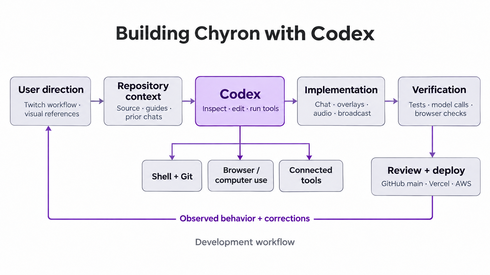

<h1 align="center">Building Chyron with Codex</h1>

Codex helped develop Chyron's Twitch integration, automatic coverage pipeline, overlay interface, audio capture, and browser broadcasting. The work took place in a local repository through successive requests, code changes, test runs, browser checks, and deployment checks. User feedback shaped both the product behavior and the implementation.

[Chyron architecture and setup](README.md) · [Devpost description](devpost.md)

## How Codex works in this workflow

Codex is OpenAI's coding agent. It works with context such as instructions, source files, conversations, and tool results, and can use available tools to carry out development tasks. In a repository workflow, a request leads to inspection, edits, command execution, and evaluation of the results. Repository guidance such as `AGENTS.md` supplies persistent project instructions. OpenAI documents these concepts in its [Codex glossary](https://learn.chatgpt.com/docs/glossary).

For Chyron, the useful context included the product brief, Twitch requirements, existing source, interface references, and specific reports of incorrect behavior. Shell tools exposed the implementation and ran checks. Browser and computer-use tools showed the rendered interface and permission flows. Connected tools supported documentation lookup and deployment inspection. Results from those tools informed the next change.



The diagram describes the observed development workflow. Chyron's running application sends coverage and transcription requests to AWS Bedrock; the production request path is documented in the [system README](README.md).

## Establishing the Twitch workflow

The main development chat, **Plan the Chyron Twitch plugin**, began with the product brief and reference images. Implementation connected Twitch authorization, chat events, evidence-backed stories, and a browser overlay, then expanded into public hosting and browser broadcasting.

The product direction became more specific during use: capture chat and spoken commentary, identify supported developments, and update the stream automatically. Earlier manual publishing, pinning, editing, and canned scenario controls were removed after feedback. That correction changed the application around its primary task. The remaining controls concern sources, reporting, appearance, visibility, and broadcast delivery.

The same chat records reference-driven interface changes, grouped settings, a separate Stories surface, 20 additional overlay designs, and controls for independent chat and voice summaries. Those requests gave Codex concrete surfaces and behavior to inspect.

## A concrete correction: unavailable quotes

A voice-only coverage request failed because the model returned a string `quoteId` when the schema required `null`. Inspection found that the prompt still allowed quote selection even when no eligible viewer message was present.

The correction changed the model-facing contract. When quotes are disabled or the supplied input has no eligible chat messages, the tool schema omits `quoteId`, and the prompt explicitly omits quote selection. The application then supplies the internal null value through typed parsing. When quoting is available, the schema restricts quote IDs to the supplied viewer messages, and selected quotes must also belong to the story's evidence.

Codex added regression coverage and ran both affected cases against the configured AWS model: voice-only input and chat input with quotes disabled. The development chat records 87 passing tests, a passing production build, and deployment of commit [5ffc169](https://github.com/victorbash400/chyron/commit/5ffc169). The implementation is in [server/editor.ts](server/editor.ts), with concise error handling in [server/coverageError.ts](server/coverageError.ts).

The reported error identified a specific mismatch; source inspection exposed its cause; schema and prompt changes addressed the same condition; model checks exercised the request that had failed.

## Verifying the rendered and broadcast result

The chat records browser inspection of the dashboard, overlay, settings, scrolling ticker, and camera/screen preview. These checks found issues that a TypeScript build could not reveal, including preview layers and the relationship between the generated headline and raw chat ticker.

One report concerned a ticker that kept moving while the central headline stayed at `LIVE UPDATES`. Browser inspection showed that both chat and voice summaries were disabled. The ticker used existing chat independently of coverage generation. Reading those states together explained the visible result and identified which control needed to change.

Browser broadcasting required another kind of check. After the user authorized Twitch's additional permission, the development session ran a private Twitch bandwidth test with generated video. The chat records successful ingest and a clean stop while the channel remained offline. That result verified the tested relay path; camera and microphone broadcasting remained a separate physical check in that session.

## Working on Chyron with Codex

Open this repository in Codex and describe a concrete change with its observable result. Name the affected surface or input, provide a reference when appearance matters, and identify the expected behavior. Keep project constraints available in `AGENTS.md`, including component boundaries, custom controls, explicit errors, and event-driven synchronization.

A useful request might be: “When a viewer message is deleted through Twitch EventSub, remove it from the ticker and dismiss any story citing it. Inspect the existing moderation path and verify both outcomes.” This gives the agent an event, a state transition, and two outputs to check.

For ordinary repository validation, use:

```bash
pnpm typecheck
pnpm test
pnpm build
```

Match additional checks to the change. A coverage change may require a real structured model request; an overlay change needs inspection at broadcast dimensions; a relay change needs a controlled ingest test. Review the diff and check the resulting behavior before publishing. Start development servers and live broadcasts only when requested.

## Development record

The main implementation chat is **Plan the Chyron Twitch plugin**, session `01a19689-0bce-7230-bef6-3d92f7ded81e`. Its record includes implementation, user corrections, verification results, and deployment work.

Git commits provide the public code record. This account uses the implementation chat and checked-in source to explain how the work was carried out, with test and provider results attributed to their recorded checks.

## License

[MIT](LICENSE).
