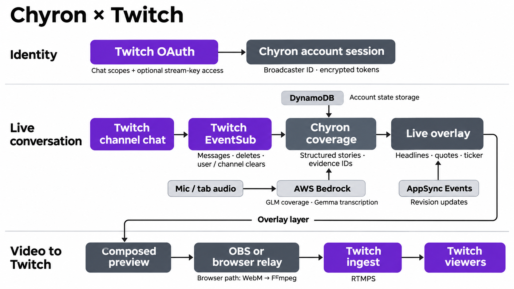
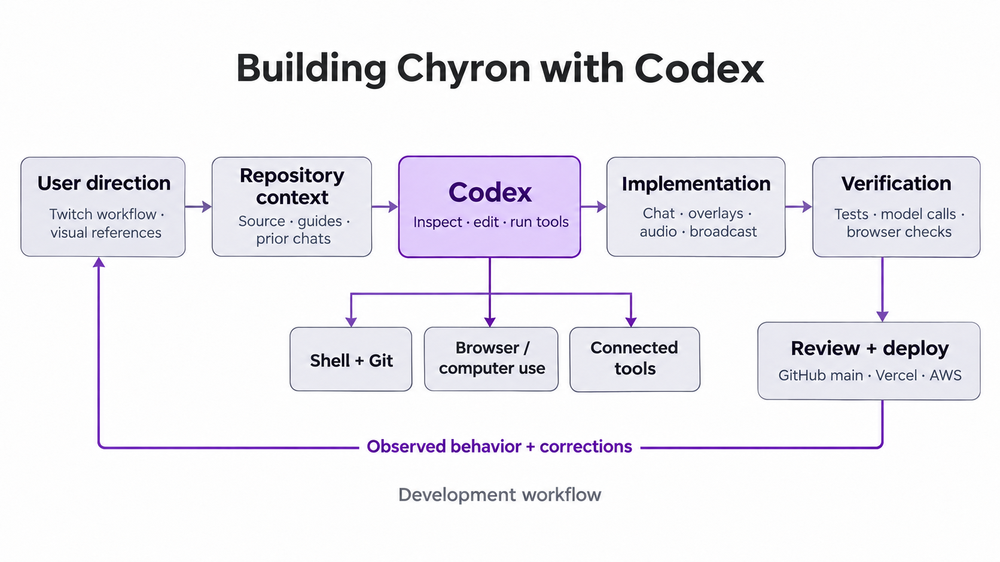

<h1 align="center">Chyron</h1>

<p align="center">
  
  
  
  
</p>

Chyron is a web application that turns Twitch chat and spoken commentary into automatically updating broadcast overlays. It groups related messages into headlines, follows developing conversations, and displays attributed viewer quotes and a scrolling chat ticker over a stream. Streamers can adjust the reporting and design, use the overlay in OBS, or broadcast from the browser.

[Open Chyron](https://chyron-six.vercel.app)

## System architecture

Twitch supplies the account identity, live conversation, moderation events, and destination for the finished broadcast. Signing in through Twitch OAuth establishes the streamer's Chyron session. EventSub delivers channel events to the hosted API, where messages enter an account-specific conversation window. The coverage pipeline sends that window and existing stories to AWS Bedrock, validates the returned story structure and supporting message IDs, and saves the resulting updates.

The dashboard and overlay subscribe to AWS AppSync Events. A revision notification triggers a fresh state request, keeping both views connected to the same saved coverage. The overlay then reaches Twitch viewers through an OBS browser source or Chyron's browser broadcast path.



### Twitch identity and permissions

The hosted application uses the signed-in Twitch user ID to select the account's room, settings, messages, and credentials. OAuth requests `user:read:chat`, `user:bot`, and `channel:bot`. Chyron validates the returned authorization and stores encrypted tokens server-side. Its session cookie is HTTP-only, and state-changing requests must match the application origin.

Browser broadcasting requests the additional `channel:read:stream_key` permission. The server retrieves the authorized broadcaster's stream key and stores it encrypted in a short-lived relay-ticket record. The browser receives a one-use token; the relay resolves it and decrypts the credential for Twitch ingest.

### Twitch chat and moderation

The hosted API subscribes to four EventSub webhook types:

| Twitch event | Chyron behavior |
| --- | --- |
| `channel.chat.message` | Adds the viewer's message, identity, and timestamp to the conversation. |
| `channel.chat.message_delete` | Removes a message and dismisses coverage that cites it. |
| `channel.chat.clear_user_messages` | Removes a viewer's messages and their dependent coverage. |
| `channel.chat.clear` | Clears channel chat evidence and dependent coverage. |

Webhook handling verifies Twitch's HMAC signature, timestamp, callback, and broadcaster identity before applying an event. Message IDs support deduplication. Moderation also changes the source generation so an in-flight analysis cannot restore removed evidence.

The integration lives in [hosted Twitch authorization](server/hosted/twitch.ts) and [EventSub handling](server/hosted/webhook.ts). The local development server uses Twitch EventSub WebSockets; the hosted application uses webhooks so delivery continues independently of a browser tab.

## From conversation to on-screen updates

### Automatic coverage

Chat summaries and voice summaries can be enabled independently. Coverage settings control the message threshold, minimum participants, context window, update delay, story lifetime, tone, and reporting focus. A streamer can choose headlines, recaps, or developments and add editorial direction.

The model returns a `submitCoverage` tool call containing headlines, summaries, status, evidence IDs, and an optional viewer quote ID. Existing story IDs let a later development update the same discussion. Chyron validates the tool output and checks it against the supplied evidence before applying it. A quote is selected from an eligible viewer message and rendered from its source text. Audio remains speaker context.

For example, a conversation about a keyboard can produce a headline supported by several viewer messages. If viewers then change their recommendation after discussing its price, the next analysis can revise that story. The story retains the connection to the messages behind it.

The configured models in [.env.example](.env.example) are GLM 5 for reasoning coverage, GLM 4.7 Flash for fast coverage, and Gemma 4 E2B for transcription through Bedrock. Model selection is resolved on the server. See [structured coverage](server/editor.ts), [story application](server/newsroom.ts), and [hosted analysis coordination](server/hosted/coverage.ts).

### Voice context

Microphone, shared-tab, or broadcast audio is captured in six-second segments while listening is active. The upload queue sends segments for decoding to mono WAV, speech detection, and structured transcription. Speech transcripts enter the coverage pipeline with an audio source label and appear in the transcript surface separately from viewer chat.

Source changes and capture cancellation invalidate pending work. Transcription accepts recordings up to 4 MB and one minute, and temporary audio files are removed after processing. See [browser capture](src/state/useAudioCapture.ts) and [transcription](server/transcription.ts).

### Overlay and ticker

The preview combines the selected camera or screen with the chat layer and chyron. The style catalogue contains 36 designs, with controls for presentation and visibility. Supported stories appear automatically; streamers can inspect their sources and dismiss or restore them.

The bottom ticker loops through up to four recent chat messages as new messages arrive. Its movement is independent of headline generation, so existing chat can continue scrolling while a summary source is disabled. The **Clear chat** action removes Chyron's chat and related updates while preserving voice context.

## Delivering the broadcast to Twitch

### OBS

Copy the overlay URL from Preview and add it as an OBS **Browser Source** at 1920 × 1080, above the camera or game source. Chyron renders the broadcast elements against a transparent background. OBS composes the scene and sends the video to Twitch. The overlay URL grants read-only access to that account's broadcast view; treat it as a capability link.

### Browser broadcasting

In desktop Chrome, choose a camera or screen under **Video source**, then use **Broadcast**. When the share picker opens, select the Chyron tab so capture can be restricted to its preview. The browser captures that composed preview and mixes source audio with the optional microphone. A `MediaRecorder` sends VP8/Opus WebM chunks over a secure WebSocket to the separate broadcast relay.

The relay validates the ticket, encodes H.264/AAC with FFmpeg at 1280 × 720 and 30 fps, and sends the stream to Twitch over RTMPS. It reports encoder progress back to the browser and stops on disconnect or upload backpressure. The encoder runs separately from the hosted API. See [browser broadcast](src/broadcast/useBrowserBroadcast.ts), [uplink](src/broadcast/BroadcastUplink.ts), and [relay encoding](relay/encoder.ts).

## Building with Codex

We used OpenAI Codex to build the Twitch integration, coverage pipeline, overlay designs, audio capture, and browser broadcast relay. Work moved from the product brief and interface references into source changes, automated checks, browser inspection, and provider tests. Feedback from the running application guided each revision.



Codex worked across the frontend, API, and infrastructure definitions. For the Twitch integration, this included OAuth, EventSub subscriptions, moderation handling, and account isolation. For broadcasting, it included preview capture, audio mixing, relay authorization, FFmpeg encoding, and a private Twitch ingest test. Source inspection and structured model checks also identified and corrected a quote-selection mismatch in voice-only coverage.

## State and deployment

React and Vite provide the interface. Vercel serves the built frontend and routes `/api/*` to the hosted handler. DynamoDB stores account rooms, individual messages, sessions, encrypted Twitch tokens, and capability records. AppSync Events provides separate account and overlay channels; its authorizer limits subscription access. Coverage leases and revision checks coordinate concurrent requests and prevent stale results from overwriting a changed source.

| Source | Responsibility |
| --- | --- |
| `src/components/`, `src/state/` | Interface surfaces, capture, API calls, and realtime subscriptions. |
| `shared/` | Typed stories, coverage settings, overlay presentation, and broadcast contracts. |
| `server/editor.ts`, `server/newsroom.ts` | Structured model requests and evidence-backed story state. |
| `server/hosted/` | Account sessions, Twitch webhooks, persisted rooms, and realtime delivery. |
| `relay/` | Authenticated browser uplink and Twitch video encoding. |
| `infra/` | CloudFormation definitions for development, hosted data, and broadcasting. |

The [production template](infra/production.json) defines DynamoDB, AppSync Events, its authorizer, and Vercel OIDC access. The [broadcast template](infra/broadcast.json) defines the relay's separate AWS infrastructure and secrets. These templates contain deployment-specific resource names and identity settings; adapt them to your account before provisioning.

## Local development

Use Node.js 26 and pnpm. Configure a Twitch developer application and a Chyron AWS development stack with DynamoDB and Bedrock access. The [development template](infra/chyron.json) provisions the foundation resources; use its outputs for the table, bucket, and Bedrock project configuration.

```bash
pnpm install
cp .env.example .env.local
```

Fill in `.env.local` with AWS access for the Chyron resources, the Bedrock project, and a random `COOKIE_SECRET` of at least 32 characters. Preserve that secret so stored Twitch credentials remain readable. Register `http://localhost:5173/api/twitch/callback` as a Twitch OAuth redirect URL and configure the Twitch client credentials.

Start the local application when ready:

```bash
pnpm dev
```

Open `http://localhost:5173`. The local Fastify server binds to loopback and serves Vite alongside its API. Its Twitch transport uses EventSub WebSockets and its UI updates use server-sent events. Keep `APP_ORIGIN` local for this runtime. Use simulation to exercise automatic coverage with generated or manually entered chat, or connect your Twitch channel.

For public hosting, use the handler built by `pnpm build` and the routing in [vercel.json](vercel.json). In addition to the shared AWS and model settings, the hosted runtime requires `TWITCH_WEBHOOK_SECRET`, `REALTIME_HTTP_HOST`, and `REALTIME_WS_HOST`. Set the public `APP_ORIGIN`, register its `/api/twitch/callback` with Twitch, and configure AWS OIDC access for your Vercel project. Browser broadcasting additionally requires `BROADCAST_RELAY_URL` and `BROADCAST_SECRET_ARN` with the relay infrastructure deployed.

## Verification

```bash
pnpm typecheck
pnpm test
pnpm build
```

The tests cover story evidence, moderation, sessions, origin checks, audio handling, overlay presentation, ticker behavior, and broadcast contracts. Provider checks are separate: `pnpm check:aws` exercises real DynamoDB, S3, and Bedrock operations, and scripts in `scripts/` cover hosted behavior, audio, and the relay. These checks require their configured services and can incur provider charges.

## License

[MIT](LICENSE). Bundled fonts retain their accompanying license notices.
